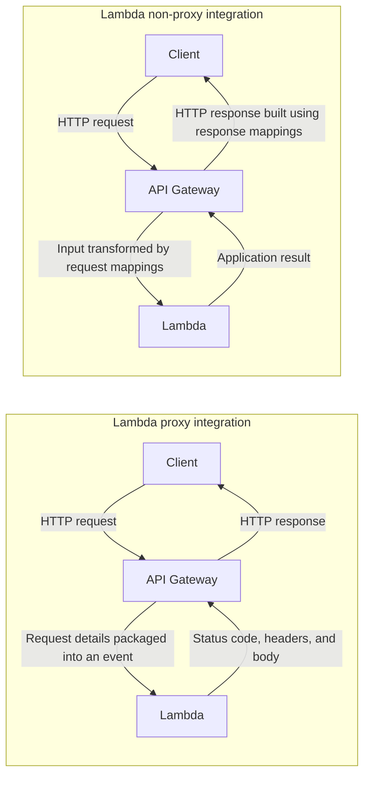

# API Gateway and Lambda

API Gateway is the HTTP front door; Lambda runs the application logic.
The integration determines how requests and responses pass between them.



In both modes, API Gateway can also handle configured authorization and
throttling. Non-proxy request and response mappings are configured in API
Gateway REST APIs.

# Creating the first project

With Node.js, npm, and the CDK CLI installed, run from your workspace directory:

```bash
mkdir product-api && cd product-api
cdk init app --language typescript
```

`cdk init` requires an empty directory and normally installs npm dependencies
automatically. If dependency installation fails, run `npm install`.

This creates the TypeScript infrastructure project; Lambda handlers will
separately use TypeScript compiled to JavaScript on the Node.js runtime.

## Project structure

Infrastructure and application code live together, but have separate roles:

```text
product-api/
|-- bin/product-api.ts          # Starts the CDK app and instantiates the stack
|-- lib/product-api-stack.ts    # Defines Lambdas, API routes, and the dev stage
|-- lambda_code/
|   |-- catalog.ts             # Shared product lookups and HTTP response helper
|   |-- data/products.ts       # Temporary in-memory product catalog
|   |-- types/index.ts         # Product and response TypeScript interfaces
|   |-- get_product.ts         # GET /products/{id}
|   |-- query_products.ts      # GET /products, optionally filtered by category
|   |-- insert_product.ts      # POST /products placeholder: returns 501
|   |-- update_product.ts      # PUT /products/{id} placeholder: returns 501
|   `-- options.ts             # CORS preflight response for both paths
|-- test/product-api.test.ts   # Checks infrastructure and route mappings
|-- cdk.json                   # Tells CDK how to run the infrastructure app
|-- package.json               # Dependencies and npm scripts
|-- package-lock.json          # Locks dependency versions
`-- tsconfig.json              # TypeScript compiler settings
```

`NodejsFunction` uses esbuild to bundle each TypeScript handler and its imports
into JavaScript. CDK defines the infrastructure; `cdk deploy` creates it in AWS.
The deployed request flow is:

```text
Client -> API Gateway (matches method and path) -> Lambda handler
       <- API Gateway (sends HTTP response)     <- status, headers, body
```

These routes use proxy integration and are unauthenticated for this tutorial.
There is no localhost HTTP server, although handlers can be invoked locally
with simulated events. The catalog is not persistent storage.
